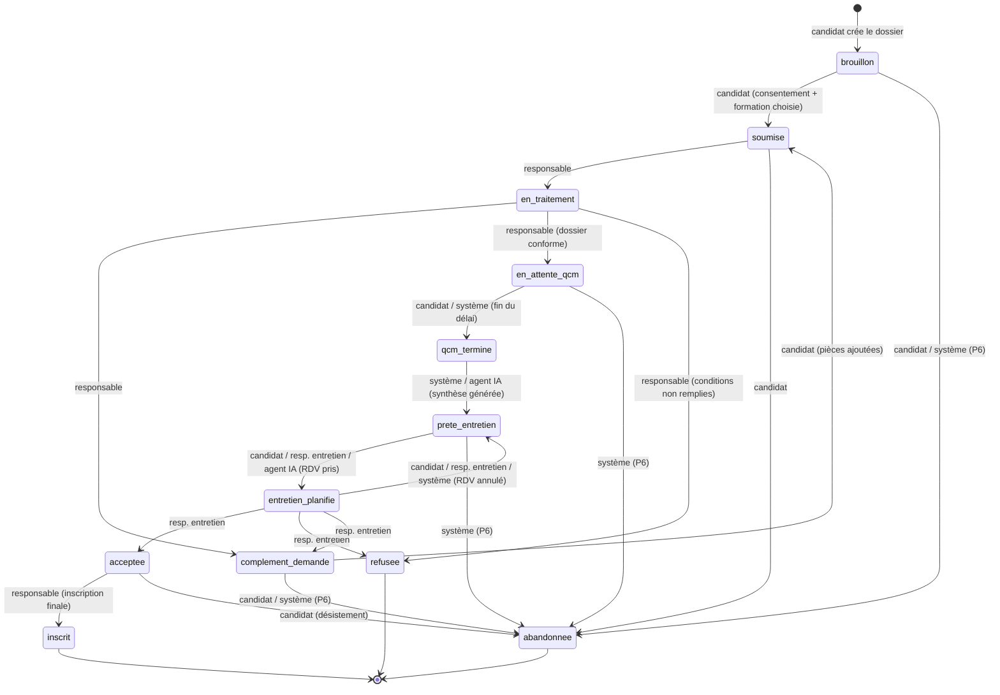

# Acteurs et processus métier — SmartCampus AI (SA-33)

Version corrigée et complétée de « Définition des processus métier » (Team 03).
Les règles de transition sont implémentées et testées dans `backend/app/domain/workflow.py`.

## 1. Acteurs

| Acteur | Hérite de | Accès | Responsabilités principales |
|---|---|---|---|
| Visiteur | — | sans compte (session anonyme) | consulter les formations, discuter avec le chatbot (texte/voix), obtenir une orientation, créer un compte |
| Candidat | Visiteur | compte `candidate` | préinscription, pièces, QCM, rendez-vous, équivalence, suivi du dossier |
| Responsable | — | (acteur abstrait) | traiter les demandes, consulter les dossiers |
| Resp. académique IIT / ISB | Responsable | `academic_iit` / `academic_isb` | valider ou ajuster les recommandations, traiter les préinscriptions et équivalences, gérer les formations de **son** établissement |
| Resp. entretien | Responsable | `interviewer` | publier ses disponibilités, confirmer les RDV, mener l'entretien, saisir la décision |
| Direction | — | `direction` | statistiques, tunnel de conversion, dossiers en attente ou abandonnés |
| Administrateur | — | `admin` | comptes et rôles, corpus RAG, paramètres des agents IA, modèles d'emails |
| Agent IA (secondaire) | — | système | dialogue, orientation, génération du QCM et des synthèses, relances — **aucune décision officielle** |
| Temps (secondaire) | — | tâche planifiée | rappels de RDV, détection d'inactivité, expiration des QCM |

## 2. Cycle de vie unique du dossier de candidature

| Statut | Libellé affiché | Statut final ? |
|---|---|---|
| `brouillon` | Brouillon | non |
| `soumise` | Soumise | non |
| `en_traitement` | En cours de traitement | non |
| `complement_demande` | Complément demandé | non |
| `en_attente_qcm` | En attente de QCM | non |
| `qcm_termine` | QCM terminé | non |
| `prete_entretien` | Prête pour entretien | non |
| `entretien_planifie` | Entretien planifié | non |
| `acceptee` | Acceptée | non (attend l'inscription) |
| `refusee` | Refusée | oui |
| `inscrit` | Inscrit | oui |
| `abandonnee` | Abandonnée | oui |

Règles clés :
- **Acceptée, refusée, inscrit** ne peuvent être décidés que par un humain : ni l'agent IA ni le système n'y ont accès (test automatique `test_no_decision_transition_open_to_ai_or_system`).
- Un saut d'étape (ex. `brouillon → acceptee`) est refusé ; toute transition passe par `change_status()`.
- Toute action du candidat remet le compteur de relances à 0 (`reminder_count`).
- Soumission impossible sans **consentement** et sans **formation choisie**.
- Chaque changement est enregistré dans `status_history` (qui, quand, pourquoi) → traçabilité + statistiques.

## 3. Processus

### P1 — Conversation et orientation *(nouveau : processus central du sujet)*

1. **Accès** : le visiteur ouvre le chat ; une session anonyme est créée (aucune donnée personnelle).
2. **Message** : il écrit ou envoie un vocal en français, tunisien ou Arabizi. Un vocal est transcrit par Whisper.
3. **Compréhension** : l'agent détecte la langue et l'intention, et met à jour la mémoire de la conversation.
4. **Construction du profil** : l'agent pose des questions adaptatives, une à la fois (niveau, section et moyenne du bac, matières préférées, objectif professionnel, contraintes).
5. **Information** : l'agent interroge le corpus officiel IIT/ISB (RAG) et cite la source de chaque réponse.
6. **Recommandation** : l'agent propose 2 à 3 formations, chacune avec une justification, un score de compatibilité et les prérequis. Il n'impose aucun choix.
7. **Comparaison** (optionnelle) : le candidat compare les formations proposées.
8. **Transition** : si le visiteur veut continuer, il crée un compte. L'historique de la conversation et le profil sont rattachés à ce compte, puis le processus P2 commence.

Sorties : profil candidat (`candidate_profiles`), recommandations au statut `proposee`, conversation conservée.

Statuts de la recommandation : Proposée (IA) → Validée ou Ajustée (responsable académique, étape 7 de P2).
Rétention : une conversation anonyme non rattachée à un compte est supprimée après `VISITOR_SESSION_DAYS` jours.

### P2 — Demande de préinscription *(corrigé)*

1. **Orientation d'abord** : le candidat part des recommandations issues de P1 (profil, résultats, intérêts, objectifs analysés par SmartCampus AI) ; il peut aussi consulter directement le catalogue.
2. **Choix de la formation** : le candidat sélectionne un parcours, proposé ou non par l'IA. Ce choix vient **après** l'orientation.
3. **Saisie des informations** : il complète son dossier personnel et académique.
4. **Pièces justificatives** : il télécharge relevés de notes, diplôme, pièce d'identité et photo.
5. **Consentement** : il accepte le traitement de ses données personnelles. La date et la version du texte sont enregistrées.
6. **Soumission** : le système enregistre le dossier, lui attribue une référence `PRE-2026-xxxxxx` et envoie un email de confirmation.
7. **Vérification** : le responsable académique contrôle la conformité du dossier et **valide ou ajuste la recommandation de l'IA** (validation humaine).
   - Dossier incomplet : statut *Complément demandé*, avec notification au candidat.
   - Conditions non remplies : statut *Refusée*, avec notification.
   - Dossier conforme : statut *En attente de QCM*.
8. **Génération du QCM** : l'agent génère un questionnaire selon la formation visée et le profil. Il couvre trois dimensions : connaissances, motivation, besoins d'accompagnement. Une date limite est fixée.
9. **Passage du QCM** : le candidat répond ; le système corrige automatiquement.
10. **Préparation de l'entretien** : l'agent calcule le score et rédige une synthèse pour le responsable d'entretien (acquis, difficultés, motivations, points à approfondir). Le dossier passe au statut *Prête pour entretien*.

Statuts : Brouillon, Soumise, En cours de traitement, Complément demandé, En attente de QCM, QCM terminé, Prête pour entretien (et Refusée si les conditions ne sont pas remplies à l'étape 7).
*La décision finale Acceptée / Refusée après entretien est prise au processus P5.*

### P3 — Demande d'équivalence *(inchangé, précisé)*

Public : candidats venant d'un autre établissement qui visent une passerelle, par exemple une entrée directe en cycle ingénieur.

1. **Accès** : le candidat connecté ouvre « Demande d'équivalence ».
2. **Saisie** : parcours académique, établissement précédent, diplômes obtenus, formation visée.
3. **Pièces** : relevés de notes, diplômes, programmes des cours suivis.
4. **Soumission** : le système attribue une référence `EQV-2026-xxxxxx`.
5. **Vérification administrative** par le responsable académique.
6. **Traitement** : dossier incomplet → *Complément demandé* ; dossier complet → évaluation.
7. **Décision finale** : acceptée ou refusée, avec un commentaire obligatoire en cas de refus.
8. **Notification** au candidat.

Statuts : Brouillon, Soumise, En cours de traitement, Complément demandé, Acceptée, Refusée.

### P4 — Demande et gestion des rendez-vous *(complété)*

1. **Prérequis** : dossier au statut *Prête pour entretien*.
2. **Disponibilités** : le responsable d'entretien publie ses créneaux (`availability_slots`).
3. **Proposition** : le système, ou l'agent dans le chat, propose les créneaux libres.
4. **Sélection** : le candidat choisit un créneau. Le RDV passe *En attente* et le dossier *Entretien planifié*.
5. **Validation** : le responsable confirme le créneau ou en propose un autre (*Reporté*).
6. **Confirmation** : un email est envoyé avec la date, le lieu ou le lien de visio.
7. **Rappel automatique** : envoyé 24 h avant le RDV.
8. **Suivi** : le candidat peut consulter son RDV, demander un report (2 au maximum) ou l'annuler. En cas d'annulation, le dossier revient à *Prête pour entretien*.
9. **Absence de réponse** : si le candidat ne choisit pas de créneau ou si le responsable ne confirme pas sous 48 h, une relance est envoyée (processus P6). Après 2 relances sans réponse du candidat, le dossier est transféré à un conseiller.

Statuts : En attente, Confirmé, Reporté, Annulé, Terminé.

### P5 — Réalisation de l'entretien *(complété)*

1. **Préparation** : le responsable consulte le profil, le résumé de la conversation, la recommandation validée, le résultat du QCM et la synthèse générée par l'IA.
2. **Déroulement** : l'entretien a lieu ; le RDV passe *Terminé*.
3. **Évaluation** : le responsable note les connaissances et la motivation (/20 chacune).
4. **Observations** saisies dans `interviews`.
5. **Décision** (humaine uniquement) :
   - Favorable : dossier *Acceptée*.
   - Défavorable : dossier *Refusée*.
   - Informations complémentaires demandées : dossier *Complément demandé*.
   - Transmis à l'étape suivante : examen par une commission.
6. **Notification** au candidat (email personnalisé).
7. **Mise à jour du statut** du dossier par `change_status()` (historisé dans `status_history`).
8. **Inscription finale** : le candidat accepté confirme et finalise son inscription (paiement des frais d'inscription), puis le responsable académique passe le dossier au statut *Inscrit*. Un désistement passe le dossier à *Abandonnée*.

Résultats de l'entretien : favorable, défavorable, informations complémentaires demandées, transmis à l'étape suivante.
Statuts du dossier concernés : Entretien planifié → Acceptée / Refusée / Complément demandé → Inscrit.

### P6 — Suivi et relance automatique *(nouveau : exigé par le sujet)*

Déclencheur : tâche planifiée quotidienne (acteur *Temps*).

1. **Détection** : dossiers non terminés sans activité du candidat depuis 3 jours (`last_candidate_activity_at`), QCM non passé avant la date limite, RDV non confirmé.
2. **Relance n°1** : l'agent rédige un email personnalisé selon l'étape bloquée. Il passe par `notifications` avec l'indicateur `generated_by_ai`.
3. **Relance n°2** : 4 jours après la première, sur un ton différent, avec une proposition d'aide.
4. **Escalade** : après 2 relances sans réponse, le dossier est attribué à un conseiller humain (`assigned_advisor_id`) avec une notification `escalade`.
5. **Abandon** : 30 jours sans activité après l'escalade, le système passe le dossier à *Abandonnée*.
6. **Réactivation** : toute action du candidat remet le compteur de relances à 0.

Sorties : relances tracées, dossiers abandonnés visibles dans le tableau de bord de la direction.

Statuts des notifications : À envoyer, Envoyée, Échec. Types : confirmation, complément, décision, rappel de RDV, relance, escalade.
Statut du dossier en fin de processus : inchangé (candidat réactivé) ou *Abandonnée*.

## 4. Tunnel de conversion (dashboard direction)

`Visiteurs (sessions)` → `Profils créés` → `Préinscriptions soumises` → `QCM terminés` → `Entretiens réalisés` → `Acceptés` → `Inscrits`

Toutes ces étapes se calculent à partir de `visitor_sessions`, `applications` et `status_history`.

## 5. Diagrammes de cas d'utilisation

Sources PlantUML (aperçu VS Code : extension *PlantUML*, `Alt+D`) :

- `docs/diagrammes/use-case-1-front-office.puml` : visiteur et candidat (P1 à P5).
- `docs/diagrammes/use-case-2-back-office.puml` : responsables, direction, administration et processus automatiques (P6).

Chaque acteur a son propre bloc de cas d'utilisation et les acteurs système (Agent IA, Temps, Service email)
sont placés à droite : aucune flèche ne se croise. L'authentification, commune à tous les cas identifiés,
est indiquée par une note plutôt que par une relation `<<include>>` vers chaque cas.
