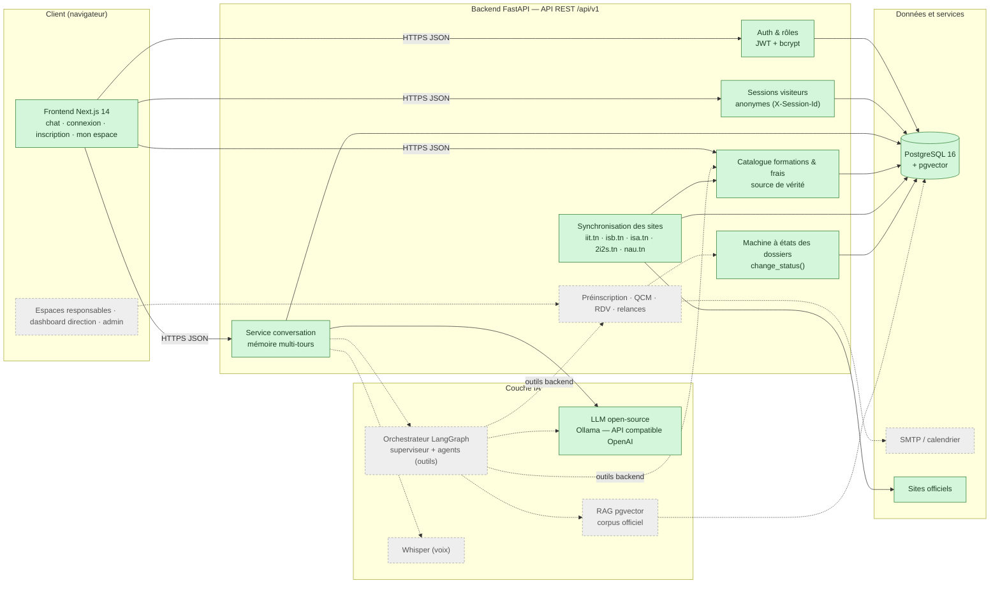
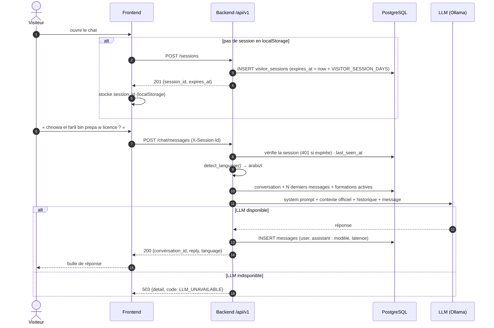

# Architecture technique — SmartCampus AI (SA-2)

SmartCampus AI est un chatbot **agentique** d'orientation universitaire pour l'IIT (Licence, Prépa, Ingénierie),
l'ISB et les établissements partenaires (ISA, 2I2S, NAU). Il dialogue en **français, dialecte tunisien et
Arabizi**, par **texte ou audio**, et accompagne le candidat jusqu'à la **préinscription**, au **QCM**, au
**rendez-vous d'entretien** et au **suivi** (relances). Les responsables et la direction disposent d'espaces
et de tableaux de bord. **L'IA conseille ; les décisions officielles restent humaines.**

## 1. Vue d'ensemble des composants

Légende : **vert = livré au Sprint 1**, gris pointillé = sprints suivants.

**Sprint 1 (Socle technique)** : auth, sessions anonymes, chat avec LLM direct (sans agents), catalogue
synchronisé automatiquement, modèle relationnel complet (y compris les workflows métier et leur machine à
états), PostgreSQL. L'orchestrateur LangGraph, le RAG, Whisper, les API de préinscription / QCM / RDV et les
dashboards arrivent aux sprints suivants et se branchent **derrière** le service *Chat* sans changer le
contrat API du frontend.

## 2. Choix techniques et justification

| Couche | Choix | Pourquoi |
|---|---|---|
| Frontend | Next.js 14 (App Router) + TypeScript | Proposé par le sujet ; SSR pour le site public, même code pour les espaces et dashboards ; typage |
| Backend | **FastAPI** (Python 3.11) plutôt que NestJS | Toute la couche IA est en Python (LangGraph, Whisper, embeddings, fine-tuning LoRA, évaluation) : une seule stack back + IA, appel direct des agents sans passerelle ; validation Pydantic et Swagger automatiques ; async natif pour le streaming LLM |
| ORM / migrations | SQLAlchemy 2 (typage `Mapped`) + Alembic | Migrations versionnées et réversibles, revues en PR |
| Base | PostgreSQL 16 + **pgvector** | Une seule base pour les données métier ET les embeddings RAG (pas de 2ᵉ service vectoriel) ; JSON natif |
| LLM | Ollama (dev), API compatible OpenAI | Changement de modèle par variable d'environnement ; modèles open-source adaptables en LoRA ; données hébergées localement |
| Auth | JWT (60 min) + bcrypt ; sessions anonymes UUID | Stateless ; le visiteur peut discuter sans compte, son historique suit le compte créé ensuite |
| Catalogue | Robot de synchronisation (httpx + BeautifulSoup) | Les données officielles viennent des sites, mises à jour automatiquement et tracées (source_url) |
| Déploiement | Docker Compose | 5 services reproductibles sur chaque poste et pour la démo |
| CI | GitHub Actions | Tests, migrations aller-retour et build frontend à chaque PR |

## 3. Règles de communication entre composants

1. **Le frontend ne parle qu'au backend** (`/api/v1/...`). Il n'appelle jamais le LLM ni la base directement.
2. **Format** : JSON, champs en `snake_case`, identifiants UUID (entités exposées), dates ISO 8601 en UTC.
3. **Erreurs** : format unique `{"detail": "message lisible", "code": "CODE_MACHINE"}` avec le code HTTP
   standard (400, 401, 403, 404, 409, 422, 503). Les erreurs de validation (422) ajoutent `errors` (liste des champs).
4. **Versionnement** : préfixe `/api/v1`. Un changement cassant = nouvelle version `/api/v2` ; les routes
   existantes de `docs/api.md` ne sont jamais cassées.
5. **Identification** :
   - visiteur anonyme → en-tête `X-Session-Id: <uuid>` obtenu via `POST /sessions` ;
   - utilisateur connecté → `Authorization: Bearer <jwt>` (contient `sub` = id utilisateur et `role`).
6. **L'IA passe par des outils du backend** : elle ne modifie jamais la base directement ; elle appelle des
   outils (ex. `get_program`, `create_preregistration`) soumis aux mêmes règles d'autorisation, et tout
   changement de statut passe par `change_status()`. **Elle ne prend jamais de décision officielle**
   (validation de recommandation, acceptation, refus, inscription) : *human-in-the-loop*.
7. **Pas de données personnelles avant consentement** : un visiteur anonyme ne fournit aucune donnée
   personnelle (la session ne stocke que la langue et le user-agent) ; nom, email, notes et pièces ne sont
   collectés qu'après création de compte et consentement explicite à la préinscription.

## 4. Flux principal du Sprint 1 : un visiteur anonyme envoie un message

## 5. Environnements

| Env | Base | LLM | Sites officiels | Usage |
|---|---|---|---|---|
| local | Docker `pgvector/pgvector:pg16` | Ollama (service Docker) | réels (synchro manuelle ou scheduler) | développement |
| test | SQLite en mémoire (StaticPool) | simulé (`LLM_PROVIDER=fake`) | simulés (pages HTML de `tests/fixtures/sites`) | `pytest`, CI GitHub Actions |
| démo | Docker Compose complet | Ollama (GPU si disponible) ou API compatible OpenAI | réels, synchro quotidienne | présentation de fin de sprint |

## 6. Rétention des données des visiteurs (SA-23)

- Une session anonyme expire après **`VISITOR_SESSION_DAYS` jours** (7 par défaut). Au-delà, l'API répond
  `401 SESSION_EXPIRED` et le frontend crée une nouvelle session.
- `python -m scripts.purge_sessions` (lancé **une fois par jour** par le service `scheduler`) supprime les
  sessions **expirées et non rattachées à un compte**, avec leurs conversations et messages (`--dry-run`
  pour un rapport sans suppression).
- Une session rattachée à un compte (inscription ou connexion) n'est **jamais** purgée : l'historique
  appartient alors au candidat identifié et suit son compte sur tous ses appareils.
