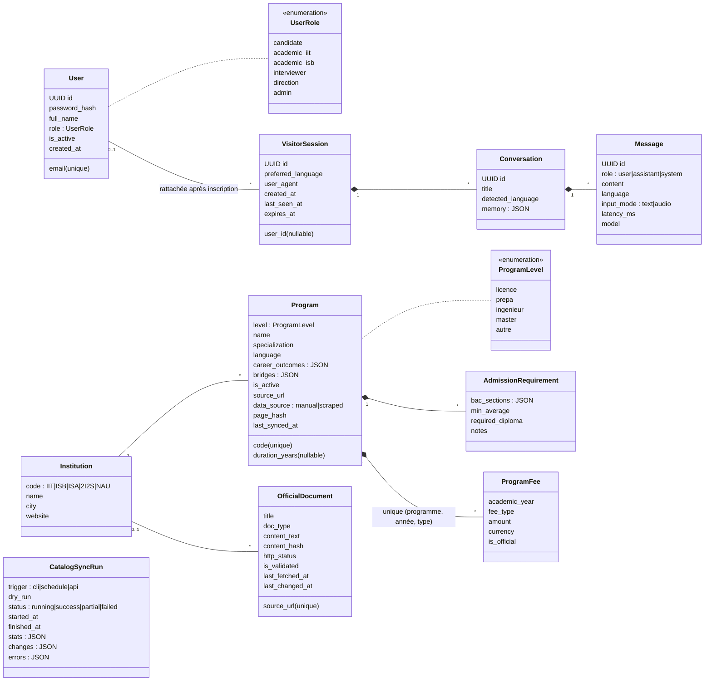
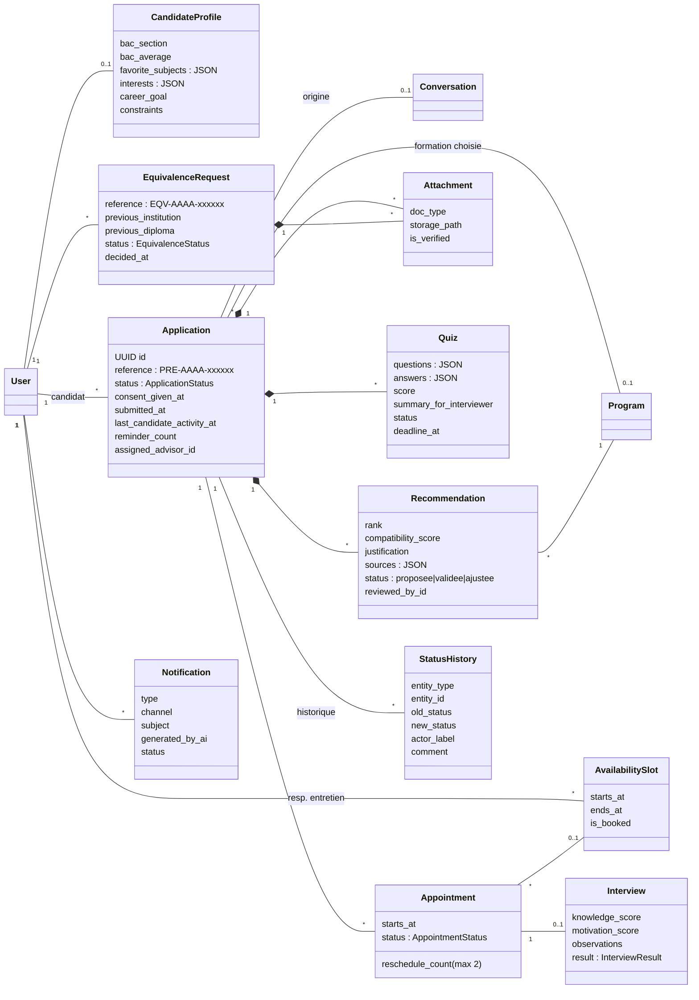

# Modèle de données — diagramme de classes (SA-11, SA-15)

21 tables PostgreSQL 16 (+ extension `pgvector` activée pour le RAG du sprint 2).
Code : `backend/app/db/models.py` (socle) et `backend/app/db/models_workflow.py` (workflows métier).

Migrations Alembic (`backend/alembic/versions/`) :

| Révision | Contenu |
|---|---|
| `0001` | socle : utilisateurs, sessions visiteurs, établissements, formations, conditions, frais, conversations, messages, documents officiels ; active `vector` si disponible |
| `0002` | workflows métier : profils, préinscriptions, recommandations, équivalences, pièces, QCM, créneaux, RDV, entretiens, notifications, historique des statuts |
| `0003` | synchronisation automatique : `catalog_sync_runs`, empreintes et dates des pages, `data_source`, durée nullable |

Conventions : clés UUID pour les entités exposées à l'API (utilisateurs, sessions, conversations, messages,
dossiers), entiers pour les référentiels ; dates `timestamp with time zone` (UTC) ; **toutes les contraintes
uniques sont nommées** (`uq_<table>_<colonne>`) pour que les downgrades puissent les supprimer ; les
downgrades suppriment aussi les types enum PostgreSQL.

## 1. Socle (Sprint 1)

## 2. Workflows métier (cf. `docs/acteurs-processus.md`)

Règles d'intégrité notables :

- une pièce jointe appartient **soit** à une préinscription **soit** à une équivalence (`ck_attachment_single_owner`) ;
- un seul tarif par (formation, année universitaire, type de frais) (`uq_program_fees_program_year_type`) ;
- `programs.duration_years` est **nullable** : une durée non écrite sur le site officiel n'est jamais inventée ;
- les statuts ne changent que via `app/domain/workflow.py::change_status()`, qui écrit dans `status_history`.
