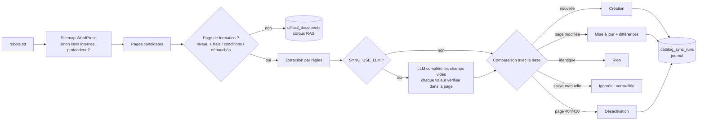

# Synchronisation automatique du catalogue (SA-19)

Le catalogue des formations (formations, conditions d'accès, débouchés, frais) est **rempli et mis à jour
automatiquement** à partir des sites officiels. Personne ne saisit les formations à la main.

| Code | Site | Nom officiel (lu sur les sites) | Résultat de la 1ʳᵉ synchro (18/11/2026) |
|---|---|---|---|
| IIT | https://iit.tn/ | Institut International de Technologie | 69 pages, **17 formations** (prépa, 8 licences, 6 filières ingénieur, mastère, architecture) avec frais |
| ISB | https://isb.tn/ | International School of Business | **0 page** : le site renvoie une page « Security check » aux robots |
| ISA | https://isa.tn/ | IIT Section of Architecture | 25 pages, **6 formations** (architecture « six ans », génies, mastères), sans frais affichés |
| 2I2S | https://2i2s.tn/ | École Internationale des Sciences de Santé | 32 pages, **1 formation** (Licence en Sciences Infirmières, 3 ans) |
| NAU | https://nau.tn/ | North American Private University | 8 pages gardées pour le RAG ; site du groupe (liste IIT, ISB, ISA), **aucune formation attendue** |

Configuration : `backend/app/scraping/sources.py` (ajouter un site = ajouter une entrée).

## Fonctionnement



## Règles de fiabilité

1. **Rien n'est inventé.** On ne garde que ce qui est écrit sur la page. Exemple : si la durée n'est pas indiquée,
   le champ reste vide. Quand le LLM est activé, chaque valeur qu'il propose (durée, débouché, section du bac…)
   doit apparaître dans le texte de la page, sinon elle est rejetée (test `test_llm_values_not_in_page_are_rejected`).
2. **Traçabilité.** Chaque formation garde `source_url`, `last_synced_at` et l'empreinte de la page. Chaque
   exécution est enregistrée dans `catalog_sync_runs`, avec le détail des champs modifiés (avant / après).
3. **Corrections manuelles prioritaires.** Une formation saisie dans `data/catalogue.json` est verrouillée
   (`data_source = manual`) : la synchronisation ne l'écrase jamais.
4. **Prudence.** Une formation n'est désactivée que si sa page répond 404 ou 410, jamais sur une coupure réseau.
   Un site injoignable n'empêche pas la synchronisation des autres.
5. **Respect des sites.** Le robot respecte `robots.txt`, s'identifie (`SmartCampusAI-bot`), envoie au plus une
   requête par seconde, ne télécharge ni PDF ni images, et visite au plus 150 pages par site.
6. **Frais.** Ils sont enregistrés tels qu'affichés, par exemple « 667DT/9 mois » devient le type
   `scolarite_9_mois`, 667 TND. L'année universitaire est celle de la synchronisation. Les sites précisent que ces
   montants sont **indicatifs** : l'assistant doit toujours le dire et renvoyer vers l'établissement.

## Utilisation

```bash
cd backend
python -m scripts.sync_sites --dry-run          # voir ce qui changerait, sans rien enregistrer
python -m scripts.sync_sites                    # synchroniser tous les sites
python -m scripts.sync_sites --site IIT         # un seul site
python -m scripts.sync_sites --use-llm          # compléter avec le LLM (valeurs vérifiées)
```

- **Automatique** : le service `scheduler` de `docker compose` relance la synchro toutes les `SYNC_INTERVAL_HOURS`
  heures (24 par défaut).
- **Purge** : le même service supprime chaque jour les sessions anonymes expirées (voir `docs/architecture.md` §6).
- **API (admin)** : `POST /api/v1/admin/catalog/sync?site=IIT&dry_run=true`, puis `GET /api/v1/admin/catalog/sync-runs`
  pour lire le journal (admin, responsables académiques, direction).

## Vérification sur les vrais sites (18/11/2026)

1. `--dry-run` sur les 5 sites, puis analyse des valeurs extraites page par page.
2. Corrections de l'extracteur, chacune avec un test sur une **page HTML réelle** enregistrée dans
   `backend/tests/fixtures/sites/<site>/reel/` :
   - « Pré-requis : Prépa | Licence | Mastère » faisait classer *Génie des procédés* en licence : le bloc des
     prérequis n'est plus utilisé pour détecter le niveau (`test_real_prerequisite_line_does_not_decide_level`) ;
   - les débouchés et modules de iit.tn ne sont pas des puces `<li>` mais des lignes de texte : lecture des lignes
     sous « Débouchés professionnels » / « Principaux modules », arrêt au pied de page (`test_real_iit_licence_page_big_data`) ;
   - les listes ne sortent plus du contenu principal : le menu du site n'est plus lu comme des débouchés ;
   - deux pages au même code (`genie-mecanique/` et `genie-mecanique-2/`) : la page la plus complète gagne ;
   - un site sans aucune page lisible (ISB) ou sans formation reconnue est signalé dans le journal (`partial`).
3. Synchronisation réelle : 24 formations créées ; un 2ᵉ passage donne 24 « inchangées » (idempotent).

## Limites connues

- **ISB** : protection anti-robot. Aucune donnée n'est récupérée ni inventée. Solutions à étudier au sprint 2 :
  demander à l'ISB un export (ou l'autorisation du robot), sinon saisie dans `data/catalogue.json` avec `source_url`.
- La **durée** des licences et du cycle ingénieur n'est pas écrite sur iit.tn : elle reste vide (affichée « non précisée »).
- Les pages en prose (ex. génie mécanique) n'ont pas de liste de débouchés : le champ reste vide ; certaines listes
  contiennent des phrases longues ou un intertitre (ex. « Perspectives » sur isa.tn).
- Une page listant plusieurs formations (ex. « Mastère », « Mastères ») produit **une seule** fiche.
- Les frais de l'ISA et de 2I2S ne sont pas affichés sur leurs pages de formation.
- Les pages IIT et ISA décrivent les mêmes filières de génie : les deux établissements apparaissent (codes distincts).

## Améliorer l'extracteur

Procédure pour toute formation manquée ou mal lue : enregistrer la page HTML réelle dans
`backend/tests/fixtures/sites/<site>/reel/`, ajouter un test, ajuster l'extracteur, relancer `--dry-run`.
